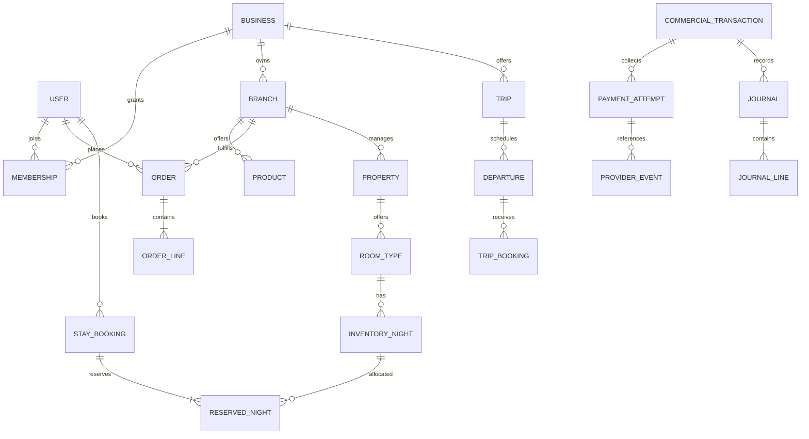
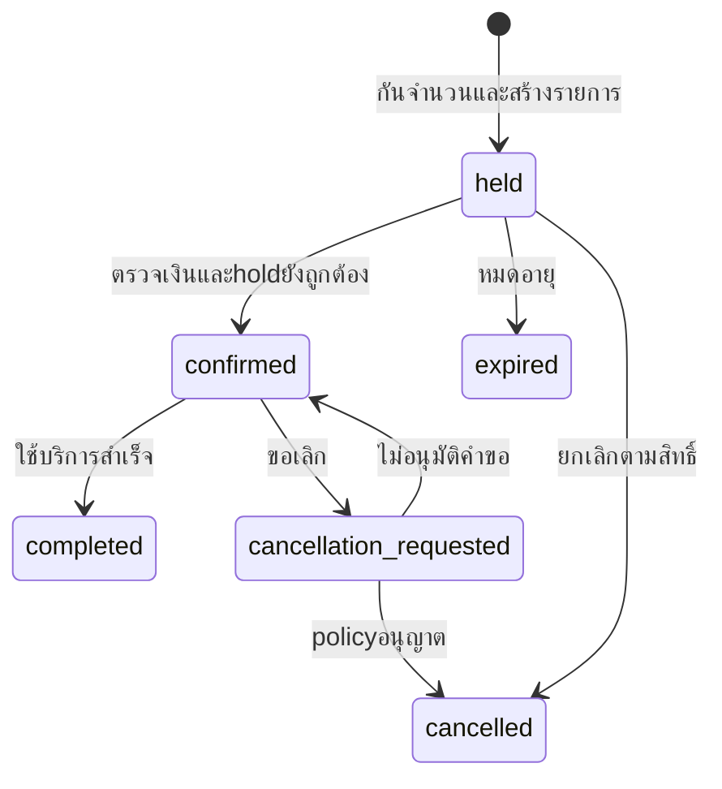
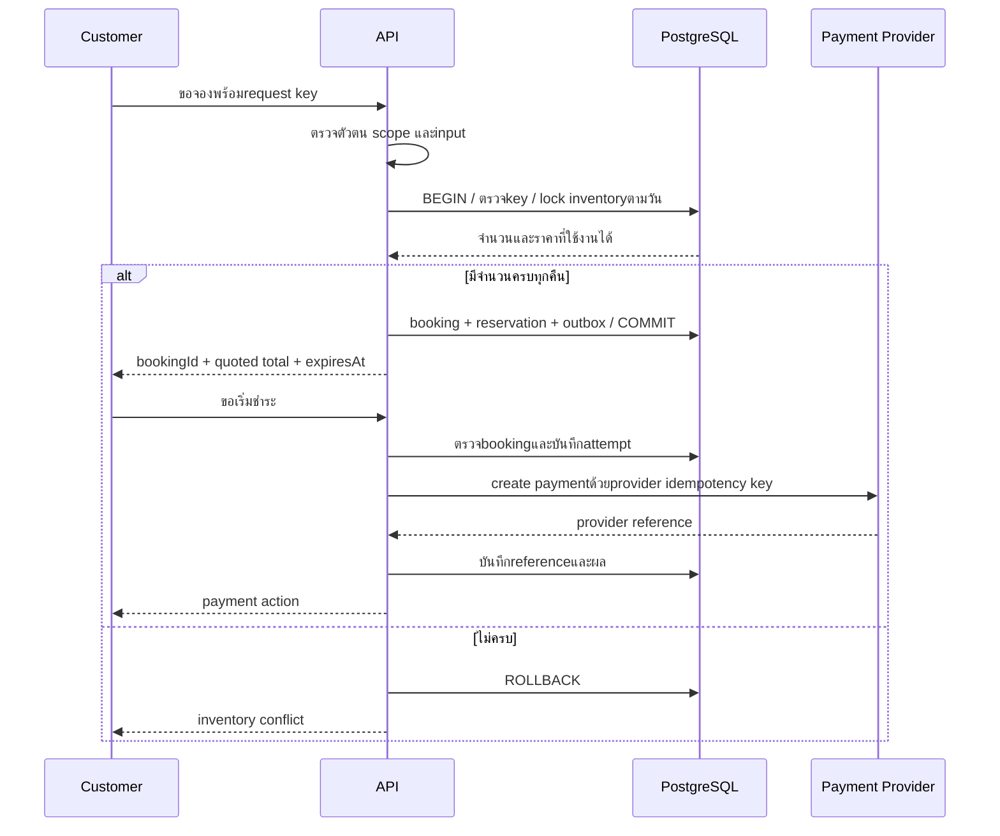

# ThinThai — Data & Runtime Contracts

แบบเชิงตรรกะ PROPOSED ไม่ใช่SQLพร้อมนำไปรัน ต้องออกmigrationและทดสอบกับฐานปัจจุบันก่อน

## 1. แบบข้อมูลแกนกลาง

ข้อจำกัดที่ต้องเสริมจากERD: commercial transactionต้องผูกกับorder/trip booking/stay bookingที่มีอยู่จริงผ่านFK/linkที่ตรวจบังคับได้ exactly oneตามชนิด ห้ามปล่อยtarget_type/idที่ชี้ข้อมูลหาย; วิธีrelationสุดท้ายต้องเลือกในADRก่อนmigration ไม่ถือว่าdiagramนี้แสดงconstraintครบ

Membershipอาจมีscopeต่อbranch; หนึ่งuserมีหลายbusinessได้. Storeเดิมต้องmapเข้าธุรกิจ/สาขาอย่างชัดก่อนบังคับคอลัมน์ใหม่

## 2. ข้อกำหนดข้อมูล

| เรื่อง | กฎเสนอ |
|---|---|
| เงิน | integer minor units + currency; APIจำนวนมากใช้decimal stringเมื่อเกินsafe integer |
| เวลา | เหตุการณ์ใช้UTC timestamptz; วันเข้าพักใช้local date + timezoneของที่พัก |
| ราคา | snapshotราคา/ส่วนลด/ภาษีที่ใช้/fee policy versionเมื่อสร้างรายการ |
| Requestซ้ำ | unique(actor,operation,key) + request hash; keyเดิมpayloadต่างคืนconflict |
| Provider events | unique(provider,event_id); เก็บผลประมวลผลและretry audit |
| Inventory | capacity/held/soldไม่ติดลบและผลรวมไม่เกินcapacity; ล็อกหลายคืนตามลำดับเดียวกัน |
| Driver | อย่างมากหนึ่งactive assignmentต่อjob; eligibilityถูกตรวจตอนacceptด้วย |
| Friendship | canonical pair unique, no self-friend, accepted/blockedสถานะแยกชัด |
| Reward | unique(source event,beneficiary,policy version,reward type) ตามกฎผลซ้ำที่กำหนด |
| Ledger | posted journalแก้ด้วยreversal/adjustment; debit=creditต่อcurrencyถ้าใช้double-entry |
| Audit | actor,action,resource,scope,reason,correlationIDและเวลา; redactPII/secrets |

เอกสารบัญชีเก็บตามpolicy retentionที่ต้องตัดสินใจ ไม่ลบแบบCASCADEตามบัญชีผู้ใช้โดยอัตโนมัติ การลบข้อมูลส่วนตัวแยกจากการเก็บหลักฐานธุรกรรมที่จำเป็น

## 3. การจอง: pending hold ไม่ใช่ชำระสำเร็จ

Payment attemptแยก pending/succeeded/failed; refundมีrequested/approved/processing/succeeded/failed; payoutแยกpending/approved/processing/paid/failed. stateชื่อเดิมในschemaไม่ต้องเปลี่ยนทันที ต้องมีmappingและแผนcompatibility

## 4. Sequence: ห้องสุดท้ายและคำขอซ้ำ

ไม่ค้างDB transactionระหว่างnetwork callไปprovider; ถ้าproviderสำเร็จแต่ตอบกลับหาย retryด้วยkeyเดิมและreconcile ไม่สร้างattemptใหม่จนกว่าจะตรวจผลเดิม

hold expiryกับpayment successต้องlockresourceตามลำดับเดียวกันและตรวจสถานะ/เวลาซ้ำในtransaction ถ้าholdถูกปล่อยแล้ว ห้ามฟื้นconfirmedโดยไม่กันinventoryใหม่ วิธีคืนเงินหรือให้เจ้าหน้าที่จัดการเป็นOPEN policy แต่ระบบต้องเก็บเงินที่รับเข้าอย่างถูกต้องและเข้าexception queue

## 5. Webhook และ Outbox

1. รับraw payload ตรวจsignature/time windowตามprovider และจำกัดขนาด
2. persist inbox eventแบบdurable ด้วยunique keyแล้วจึงackตามprotocol ไม่ackก่อนเก็บจนเสี่ยงเหตุการณ์หาย
3. Worker claimงานด้วยlease; duplicateไม่สร้างfinancial effectซ้ำ
4. ตรวจprovider reference,amount,currency,accountและdomain target ไม่ใช้statusอย่างเดียว
5. ในtransactionบันทึกpayment/domain transition/journal/outboxเมื่อเงื่อนไขครบ
6. Outboxส่งnotification/referral eventsแบบat-least-once; consumerต้องdeduplicate
7. retryแบบbackoff,มีmaximum/failed queueและmanual replayที่auditได้
8. reconciliationตรวจpendingผิดปกติและเทียบproviderอย่างสม่ำเสมอ

กรณีprocessตายหลังcommitก่อนackยังต้องทำซ้ำโดยผลเหมือนเดิม ไม่มีการอ้างexactly-once transport

## 6. Dispatch และ Creator

Dispatch: requested → offering → assigned → at_pickup → picked_up → at_dropoff → delivered. Offerมีexpiry; คำขอตอบรับตรวจjobยังว่าง,offerยังใช้ได้,driverapproved+service typeและactive workload แล้วclaimแบบatomic. ข้อมูลติดต่อเปิดเฉพาะงาน/ช่วงเวลาที่จำเป็น

Creator: under_threshold → eligible_to_apply → pending_review → approved → paused/reviewเมื่อมีเหตุ. CONFIRMEDเพียงเกณฑ์500; mutual accepted friendsและmanual reviewเป็นPROPOSED. รายได้เกิดจากeligible referral completion ไม่ใช่จำนวนเพื่อนหรือยอดวิวอย่างเดียว

แยกfriendship graph,eligibility decision,referral attribution,reward accrual,settlement. เงินกับคะแนนคนละledgerและpolicy. เมื่อrefundให้ทำreversalตามpolicy ไม่ลบรายการเดิม. ถ้าเพื่อนลดลง วิธีจัดการรายได้อนาคต/ระยะผ่อนผันเป็นOPEN ไม่ยึดรายได้เดิมอัตโนมัติจากการเปลี่ยนตัวเลข

## 7. API Contract ตั้งต้น

OpenAPIต้องใช้DTOที่เผยแพร่ได้ ไม่ส่งDB entitiesตรง. error envelopeเสนอ `{ code, message, requestId, fieldErrors? }` ไม่มีstack trace/secret. รายการจำนวนมากใช้cursor paginationและlimitสูงสุด

| Endpointเสนอ | สิทธิ์ | ป้องกันผลซ้ำ/การแข่งขัน |
|---|---|---|
| POST /v1/stay-bookings | ลูกค้าตนเอง | key + atomic holdทุกคืน |
| POST /v1/payment-attempts | เจ้าของtransaction | key + target state + provider key |
| POST /v1/webhooks/payments/:provider | provider signature | inboxunique + transition check |
| POST /v1/driver/offers/:id/accept | driverที่ได้รับoffer | compare-and-set + expiresAt |
| POST /v1/creator/applications | เจ้าของprofile | servercount + active application constraint |
| POST /v1/admin/refunds/:id/approve | finance approve+scope | version + separate approverตามpolicy |

ตารางนี้ไม่ใช่รายชื่อrouteที่มีอยู่จริง Prefixเดิม `/api/v1` และcompatibilityต้องรักษาหรือversionอย่างชัดเจนในimplementation

## 8. แผนเปลี่ยนข้อมูลเดิม

Expand → backfillแบบแบ่งชุด → verify → switch readers/writers → observe → contractภายหลัง. migrationที่ใช้แล้วไม่แก้ย้อนหลัง; ก่อนลดschemaต้องยืนยันไม่มีcodeรุ่นเก่าใช้. Rollbackแอปไม่หมายถึงลบข้อมูลใหม่ด้วยdown migration

Store→business/branch, legacy ledger→journalและpayment target relationต้องมีmigration mapping พร้อมยอดก่อน/หลัง. ห้ามแปลงประวัติเงินโดยประมาณหรือเปลี่ยนค่าธรรมเนียม5%ในโค้ดเป็นอัตราธุรกิจจริงโดยไม่ตกลงpolicy
