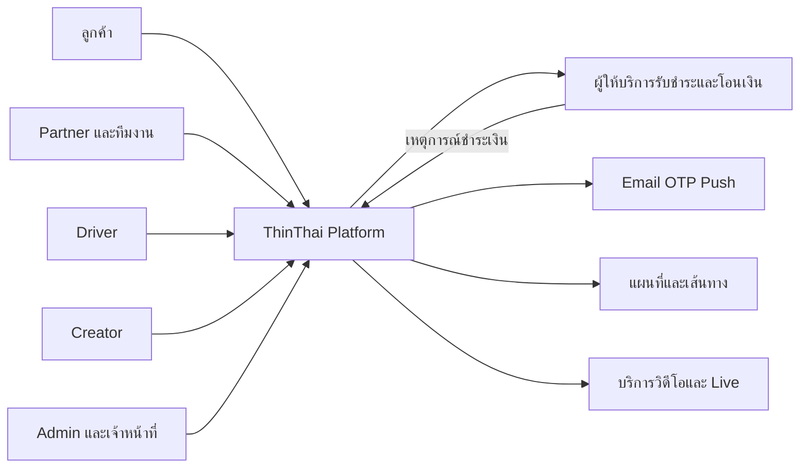
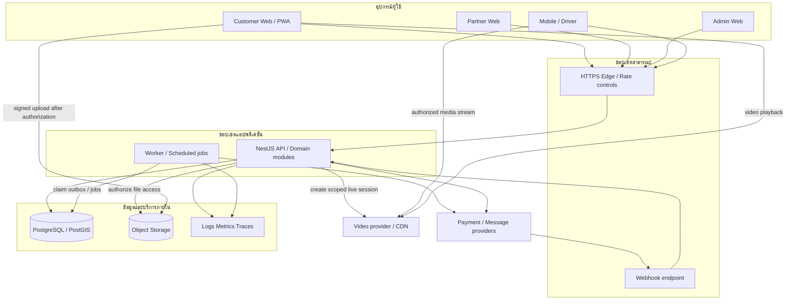

# ThinThai — System Framework

สถานะทุกแผนภาพ: PROPOSED target architecture วันที่8ตุลาคม2026 ไม่ใช่แผนผังทรัพยากรที่deployแล้ว

## 1. Context: ผู้ใช้และระบบภายนอก

ThinThai รับผิดชอบกฎธุรกิจ สิทธิ์ inventory ledger และการแสดงสถานะ ส่วนผู้ให้บริการภายนอกรับผิดชอบบริการของตน ต้องมีadapterและแผนเมื่อขัดข้อง ข้อมูลสำเร็จที่แสดงบนหน้าclientไม่แทนผลตรวจสอบจากbackend

## 2. Container: องค์ประกอบที่รันแยกได้

ข้อเสนอเริ่มต้นใช้ durable jobs/outboxในPostgreSQLเพื่อลดระบบที่ต้องดูแล เมื่อโหลดหรือคิวงานต้องการค่อยเลือกbrokerเฉพาะ DBยังคงแหล่งข้อมูลหลัก การส่งวิดีโอไม่วิ่งผ่านAPIธุรกรรมทั้งหมด

Webhookต้องตรวจsignature/raw payloadตามprovider แยกจากbrowser-origin/CSRF middleware โดยไม่ถอดการป้องกันของrouteอื่น

## 3. พื้นที่โค้ดเป้าหมายและของเดิม

| พื้นที่ | ปัจจุบันที่อ่านพบ | เป้าหมาย |
|---|---|---|
| apps/web | Next.jsรวมpublicและworkspace | แยกroute/customer/partnerชัด โดยไม่ต้องสร้างdeploymentเพิ่มทันที |
| apps/admin | Scaffold | Admin UIใช้APIที่ตรวจaction/scopeเหมือนทุกช่องทาง |
| apps/api | NestJS providersแยกไฟล์ธุรกิจ | module boundary, application service, repository และadapter |
| apps/worker | Scaffold | expiry,outbox,notification,reconciliationพร้อมretry |
| apps/mobile | Flutterมีโค้ดและการเชื่อมบางส่วน ต้องauditใหม่ | Customer/Driverที่ยืนยันพฤติกรรมกับAPIจริง |
| packages/domain | Scaffold | กฎpureฝั่งserver เช่นtransition/amount; ไม่importเข้าclientโดยเผลอ |
| packages/contracts | Scaffold | OpenAPI/DTO/error/event versionที่เผยแพร่ได้ |
| packages/ui/i18n | ต้องตรวจimplementationเป็นรายส่วน | tokens/components/ข้อความร่วมกับaccessibility |
| database/migrations | 001–008 | append-only migrationsพร้อมbackfill/compatibility |

ไม่ย้ายไฟล์จำนวนมากในงานเดียว เริ่มแยกโมดูลจากธุรกรรมที่กำลังแก้และมีtestsป้องกัน ยืนยันboundaryด้วยimportsและCIภายหลัง

## 4. โมดูลและเจ้าของข้อมูล

| โมดูล | เป็นเจ้าของ | การเชื่อมสำคัญ |
|---|---|---|
| Identity & Access | users, contacts, sessions, grants | ทุกโมดูลถามสิทธิ์; ไม่เชื่อroleที่clientส่ง |
| Businesses | organizations, branches, memberships, applications | Catalog/Stays/Tripsอ้างธุรกิจและสาขา |
| Geography | administrative areas, service zones | Food/Rides/Servicesใช้zoneของประเภทตน |
| Catalog & Inventory | products, stock, reservations | Commerceสั่งกัน/คืนstockผ่านเจ้าของ |
| Commerce | checkout, merchant orders, immutable lines | Paymentsอ้างยอดและorderที่ตรวจแล้ว |
| Trips | trips, departures, capacity, bookings | กันที่นั่งในtransactionเดียวกับbooking |
| Stays | properties, room types, nightly capacity, stay bookings | กันทุกคืนแบบatomic |
| Food | menus, hours, food order lifecycle | Dispatchรับงานหลังร้านยืนยันตามกฎ |
| Dispatch | drivers, eligibility, offers, assignments, job events | Food/Ridesอ้างjob; Driverตอบรับแบบatomic |
| Rides | fare quote, vehicle class, ride lifecycle | Dispatchใช้สิทธิ์รับผู้โดยสารแยกส่งอาหาร |
| Services | scope, quotes, appointments, acceptance | เพิ่มงานต้องยอมรับราคาก่อน |
| Payments & Accounting | attempts, provider inbox, journals, refunds, payouts | ประสานdomainเพื่อsettle ไม่แก้stateข้ามโมดูลตามอำเภอใจ |
| Creator & Rewards | friendships, eligibility, attribution, reward entries | รับeligible completion/refund events |
| Content & Moderation | posts, clips, live metadata, reports, actions | Videoแยกservice; ปักcatalogที่เข้าถึงได้ |
| Support / Notifications / Audit | cases, deliveries, audit trails | ตรวจscopeและปิดบังข้อมูลในทุกช่องทาง |

Business capabilityไม่จำเป็นต้องเป็นprocessแยก ทุกโมดูลในAPIใช้DBเดียวเริ่มต้นได้ แต่ขอบเขตwriterชัด; transactionที่ข้ามโมดูลผ่านapplication service ไม่ทำSQLกระจัดกระจายจากUI

## 5. Multi-vendor และ checkout

PROPOSED: รุ่นนำร่องหนึ่งmerchantต่อorderและcheckoutก่อน ตามฐานorders.store_idที่มีอยู่ ตะกร้าข้ามร้านแสดงแยกร้านและชำระแยกจนกว่าจะออกแบบparent checkout/payment allocation/refundครบ ห้ามแสดงว่าจ่ายครั้งเดียวครบทุกร้านหากbackendยังไม่รองรับ

ระยะถัดไป parent checkoutมีmerchant ordersหลายรายการ พร้อมallocationเงินและค่าจัดส่งของแต่ละร้าน แยกreturn/refundต่อรายการได้ ไม่แก้ledgerเบื้องต้นโดยเพิ่มarrayร้านในUIอย่างเดียว

## 6. เส้นแบ่งความเชื่อถือ

1. Browser/mobile: inputไม่เชื่อถือ ต้องvalidateราคา scope และสถานะใหม่
2. API: ตรวจsession+action+resource scopeก่อนอ่าน/เขียน/ส่งไฟล์
3. DB: private endpoint, service roleสิทธิ์ต่ำ, migration roleแยก
4. Worker: ตรวจpayloadและpolicyใหม่ก่อนผลที่มีสิทธิ์สำคัญ ไม่รับบทบาทจากeventเป็นอำนาจ
5. Provider: signature/event IDเป็นหลักฐาน; return URLไม่ใช่ผลชำระเงิน
6. Storage: private-by-defaultสำหรับเอกสาร; signedURLมีอายุจำกัดและออกตามscope
7. Admin: MFA, auditและการอนุมัติเงินแยกคนตามpolicy ไม่มีblanket bypassที่customer endpoint

## 7. สิ่งที่จงใจยังไม่ล็อก

Cloud/region, payment provider, OTP/video/maps provider, native Driver packaging, search engine, queue broker และขนาดเครื่อง ขึ้นกับbudget/team/workloadและผลทดลอง ไม่ใช้คำว่า“รองรับล้านคน”แทนbenchmark
